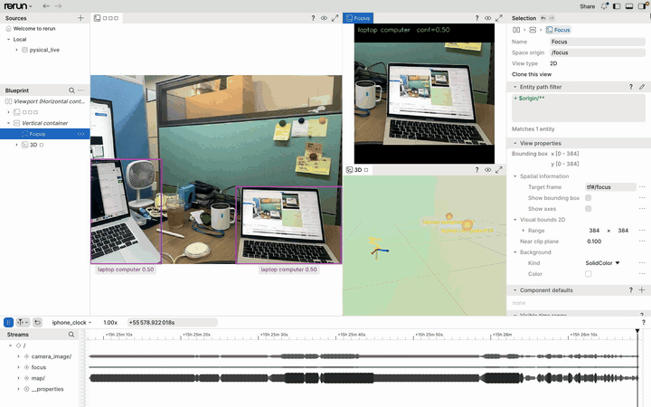
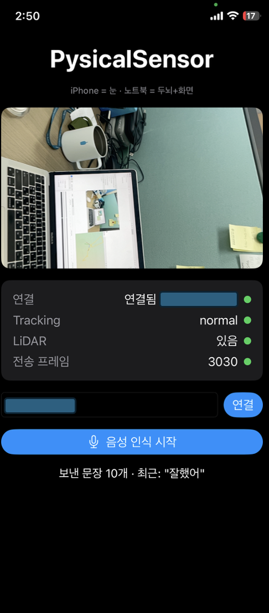
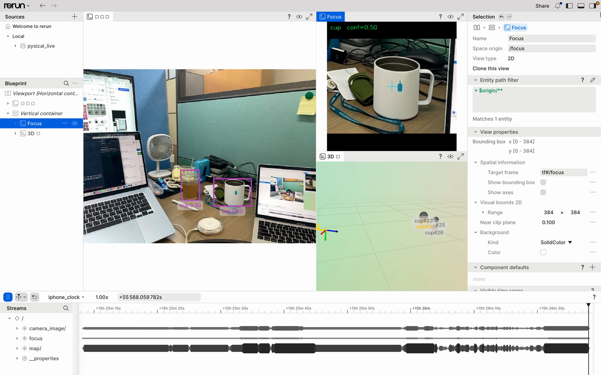

# Physical AI — Open-Vocabulary 3D Spatial Perception

> Mobile RGB-D · ARKit VIO · Open-Vocabulary Detection · Metric 3D Localization · ROS2/TF2

Point an iPhone at a desk, say *"find the cup"*, and get back where that cup is
in the world — in metres, in a frame a robot arm can actually reach into.

The phone is only a sensor. It streams RGB frames, camera intrinsics and ARKit
6-DoF poses over WebSocket to a laptop, which runs open-vocabulary detection,
lifts the detection to a metric 3D point, and converts it into the robot's
`base_link` frame as a pick target.



*Live run. The prompt switches from `"laptop computer"` to `"cup"` mid-session —
no retraining, no model swap. Left: camera feed with masks and boxes. Centre:
auto-focus view of the selected target. Right: the 3D view, where `cup23`,
`cup25` and `cup28` hold stable world coordinates and keep their instance IDs
as the camera moves. Full clip: [`docs/media/demo.mp4`](docs/media/demo.mp4).*

---

## Table of contents

- [Why this problem](#why-this-problem)
- [How it works](#how-it-works)
- [Three paths to depth](#three-paths-to-depth)
- [Coordinate frames](#coordinate-frames)
- [Installation](#installation)
- [Usage](#usage)
- [Evaluation](#evaluation)
- [Project layout](#project-layout)
- [Status and roadmap](#status-and-roadmap)
- [Known limitations](#known-limitations)

---

## Why this problem

The textbook way to get 3D object positions in robotics is a fixed, calibrated
RGB-D camera. It works, but it assumes two things: the camera does not move, and
a depth sensor exists.

This project breaks both assumptions. The camera is handheld and free to move,
and the workspace is never measured in advance — no ArUco markers on the table,
no pre-computed extrinsics. Instead, ARKit's visual-inertial odometry supplies a
6-DoF camera pose every frame, and every coordinate transform is built on top of
that.

So the question is:

> Without fixed installation or prior calibration, using only a handheld
> consumer phone, how far can you get toward robot-grade 3D spatial perception —
> and how much accuracy do you lose without LiDAR?

The second half matters. The iPhone 12 Pro used here *does* have LiDAR, so LiDAR
is treated **as ground truth, not as the method**. LiDAR-free approaches are
implemented first, then scored in centimetres against the LiDAR depth. That turns
"it works without LiDAR" from a claim into a measurement.

### Demo scenario

The clip above is a real run: the prompt starts at `"laptop computer"`, both
laptops are picked up, then it switches to `"cup"` and both cups are picked up
instead — same model, same session.

The designed stress-test scenario goes one step further. A desk with a cup and a
mouse on it, and a water bottle held in the hand. Saying `"bottle"` tracks the
bottle; switching to `"cup"` moves to the cup instantly; `"cup and mouse"`
tracks both at once.

Swapping the prompt costs one text-embedding pass — milliseconds. No retraining,
no model swap. That is the point of going open-vocabulary. Tracking several
objects at once is effectively free too, since the image encoder runs once
regardless.

This scene is deliberately chosen. The cup and the mouse sit on the detected
table plane, so plane raycasting locates them well. **The bottle in the hand does
not.** A ray cast at the bottle passes through it and hits the table behind, so
plane raycasting returns a badly wrong position, while monocular depth and
LiDAR do not. One scene exposes the difference between the two methods.

```
      cup on desk      bottle in hand      mouse on desk
          ●                  ●                   ●
     ┌────┴──────────────────────────────────────┴───┐
     │            detected plane (desk)              │
     └───────────────────────────────────────────────┘
                         ↑
                only the bottle is off this plane
```

A word on "real time": the display runs smoothly at 30 fps, but **detection
itself runs at 2–5 Hz** and a tracker fills in the frames between. Yank an
object quickly and the box lags by about half a beat.

Output goes to two places — box/mask overlays on the live video, and 3D markers
in the viewer. The second is the real result: **rotate the camera until the
object leaves the frame and the marker stays where it was**, because it was
recorded in world coordinates. That is the step from "it is somewhere on screen"
to "it is somewhere in the room".

---

## How it works

```
               natural-language prompt
                      "red mug"
                          │
                          ▼
┌─────────────────────────────────────────────┐
│  iPhone 12 Pro  —  sensor gateway           │
│                                             │
│  rear RGB camera                            │
│  ARKit world tracking  → T_world_camera     │
│  camera intrinsics K                        │
│  plane detection       → ARPlaneAnchor      │
│  sceneDepth (LiDAR)    → ground truth       │
│  tracking state                             │
└──────────────────┬──────────────────────────┘
                   │
              Wi-Fi / WebSocket
                   │
                   ▼
┌─────────────────────────────────────────────┐
│  laptop  —  perception                      │
│                                             │
│        ┌──────────────┴──────────────┐      │
│        ▼                             ▼      │
│  closed-set detector        open-vocabulary │
│  (fine-tuned, baseline)         detector    │
│        └──────────────┬──────────────┘      │
│                       ▼                     │
│                  mask / bbox                │
│                       ▼                     │
│                target selection             │
│                       ▼                     │
│             contact-point pixel (u,v)       │
│                       ▼                     │
│          ┌────────────┴────────────┐        │
│          ▼            ▼            ▼        │
│    plane raycast  mono depth   sceneDepth   │
│      (method A)    (method B)  (ground truth)│
│          └────────────┬────────────┘        │
│                       ▼                     │
│              camera XYZ → world XYZ         │
└──────────────────────┬──────────────────────┘
                       │
                       ▼
┌─────────────────────────────────────────────┐
│  ROS2                                       │
│  TF2:  map → base_link → camera_link        │
│                       → detected_object     │
│  /object_target  (PoseStamped)              │
│  RViz2 / Foxglove                           │
└─────────────────────────────────────────────┘
```



**The phone runs no inference.** It is a sensor gateway and nothing else. That
split matters twice over: the architecture ends up shaped like a real robot
system (edge sensors, central compute), and no time is spent squeezing
foundation models onto mobile hardware.

<br clear="all">

### Transport

The laptop is discovered automatically over Bonjour (`NWListener` / `NWBrowser`)
— typing an IP by hand breaks every time the network changes. Frames travel as
binary WebSocket messages carrying a timestamp, JPEG-encoded RGB, intrinsics
(fx, fy, cx, cy), the 4×4 `T_world_camera`, tracking state, and detected plane
anchors.

Bandwidth drives two design choices. RGB at 640×480 JPEG is ~40 KB/frame, so
15 fps is ~5 Mbps — comfortable over Wi-Fi. Raw float32 sceneDepth would be
196 KB/frame, or 24 Mbps at 15 fps, which is not. Depth is therefore **quantised
to uint16 millimetres** (half the size) and sent at only ~5 Hz, since it is used
for evaluation rather than for the live loop.

### Detection

On a 16 GB M1 the realistic choices are **YOLO-World** or **OWLv2-base**.
Grounding DINO scores better but runs at 1–3 FPS on MPS, which does not fit a
live demo.

Detection does not run every frame. It runs at **2–5 Hz with tracking in
between**. This saves compute, and it also damps the 3D coordinate against a
single bad detection frame.

### Instance identity

With several objects, the hard part is not the count — it is keeping track of
*which is which* across frames. If two cups swap coordinates frame to frame,
their markers jump around.

The usual fix is a 2D tracker such as ByteTrack. **This project has something
better available: it already has world coordinates.** If a cup was at
`(0.43, -0.62, -1.14)` last frame and this frame's detection lands within a few
centimetres, it is the same cup. 3D proximity association is more robust than 2D
tracking, because it survives brief occlusion and large camera motion — the
object's physical position does not change even when its screen position does.

The side effect is larger than the fix. Once every instance has a stable ID and
a stable world coordinate, that is effectively a small **object map**: objects
that leave the frame stay on the list, and are recognised as the same object when
seen again.

### Output topics

Everything matching the prompt is detected and published, but the output layer
separates two different things — *what was seen* (all of it) and *what the arm
should pick* (exactly one).

| Topic | Type | Contents |
| --- | --- | --- |
| `/detected_objects` | `vision_msgs/Detection3DArray` | every instance, with class, score, 3D position |
| `/detected_markers` | `visualization_msgs/MarkerArray` | all instances, for RViz |
| `/object_target` | `geometry_msgs/PoseStamped` | the single one chosen by policy |

Selection policy is one of highest score, nearest to screen centre, or nearest to
camera, with manual override by tapping the screen.

---

## Three paths to depth

All three start from **the same pixel** and run **the same transform**, so any
difference in the result is purely a difference in depth estimation.

| | Method | Needs | Breaks when |
| --- | --- | --- | --- |
| **A** | ARKit plane raycast | nothing extra | object is not resting on a detected plane |
| **B** | monocular metric depth | ONNX depth model | scale drift between scenes |
| **GT** | ARKit `sceneDepth` | LiDAR | — (used as reference) |

**Method A** picks the contact-point pixel where the object's segmentation mask
meets the floor, builds that pixel's camera ray from the intrinsics, and
intersects it with the horizontal plane ARKit has found. It is cheap and needs no
extra sensor, but only holds if the object is on the plane.

Using the **contact point** rather than the bbox centre is essential. The centre
produces a coordinate biased forward by half the object's height, every time.

**Method B** runs a metric-depth model on the single RGB frame, reads depth over
the object mask, back-projects to a 3D camera point, and moves it to world space
with the ARKit pose. No plane constraint, but the metric scale drifts.

---

## Coordinate frames

This is the easiest part of the project to get wrong. **ARKit numbers handed
straight to ROS will be wrong**, because the two systems use different axis
conventions.

| System | Convention |
| --- | --- |
| ARKit world | right-handed, **Y up** (against gravity) |
| ARKit camera | OpenGL style — X right, Y up, **Z backward** (view direction is −Z) |
| ROS map (REP-103) | X forward, Y left, Z up |
| ROS camera optical | X right, Y down, Z forward |

Two conversions follow:

```
camera axes:  ARKit (x, y, z)  →  optical (x, −y, −z)
world axes:   ARKit (x, y, z)  →  ROS map (−z, −x, y)
```

Both have determinant +1, so handedness is preserved.

**Verify the signs by measurement, not by reading.** Push the phone one metre in
a known direction and check that the camera in the viewer moves one metre the
same way. That is faster and more conclusive than reading the docs ten times.

```
map  (= ARKit world origin)
 └── base_link  (virtual robot, fixed pose within map)
      └── camera_link
           └── camera_optical_frame
                └── detected_object
```

With no physical robot, ARKit's world origin is used directly as ROS `map`, and
one fixed point in the space is defined as the virtual robot's `base_link`.
`T_map_camera` and `T_map_object` come from ARKit and `T_map_base` is chosen, so
the quantity actually wanted — `T_base_object` — follows.

---

## Installation

Requires **Python 3.12+**. On Apple Silicon, use an arm64 interpreter; an x86_64
Python build will fail to import numpy under Rosetta.

```bash
git clone https://github.com/paulms77/physical-ai.git
cd physical-ai

# arm64 virtualenv inside the project
uv venv --python 3.12 .venv
source .venv/bin/activate

# Phase 0 — transport + visualisation only (no models, no torch)
pip install -r requirements-phase0.txt

# Phase 1 — adds detection and depth inference
pip install -r requirements-phase1.txt

# make `import pysical` work without PYTHONPATH
pip install -e .
```

> `requirements-phase1.txt` replaces `opencv-python` with
> `opencv-contrib-python` (needed for `dnn_superres`). The two cannot coexist —
> uninstall the former first. contrib is a superset, so nothing is lost.

### Model weights

`weights/` is gitignored. Download into it before running Phase 1:

| File | Source |
| --- | --- |
| `yoloe-11s-seg.pt` | ultralytics YOLOE release |
| `depth_anything_v2_vits_indoor.onnx` | [fabio-sim/Depth-Anything-ONNX](https://github.com/fabio-sim/Depth-Anything-ONNX) releases |
| `ESPCN_x2.pb`, `ESPCN_x3.pb`, `ESPCN_x4.pb` | [fannymonori/TF-ESPCN](https://github.com/fannymonori/TF-ESPCN) (~90 KB each) |

### Optional — conversational voice control

Voice intent parsing uses a local Ollama model, and falls back to a rule-based
parser when Ollama is absent.

```bash
ollama serve &
ollama pull qwen2.5:3b
```

---

## Usage

### Without a phone — replay or mock

Nothing below needs an iPhone, so the pipeline can be exercised on any machine.

```bash
# synthetic frames through the full transport path
python scripts/run_mock_sender.py --fps 15 --duration 20
python scripts/run_receiver.py

# single still image: detect + localise
python scripts/detect_image.py --image data/desk.jpeg --prompt "cup mouse"

# same, with LiDAR depth for real 3D coordinates
python scripts/detect_image.py --image data/desk.jpeg --prompt "cup" \
    --depth data/desk_depth.npy --fx 1590 --fy 1590 --cx 960 --cy 720

# replay a recording through the whole pipeline
python scripts/replay_recording.py --rec data/recordings/desk.pyrec \
    --prompt "cup" --save out.rrd

# detect-and-track loop over a recording
python scripts/run_realtime.py --rec data/recordings/desk.pyrec \
    --prompt "cup" --detect-every 5 --viz --focus
```

### With an iPhone — live

```bash
# 1. find the laptop's LAN address (en0 is Wi-Fi) to enter in the app
ipconfig getifaddr en0

# 2. start the live receiver
source .venv/bin/activate
python scripts/run_live.py --prompt "cup" --viz --focus
```



*The rerun viewer during a live run — camera feed with detections, the
auto-focus panel, the 3D world view and the per-stream timeline.*

Forgetting `source` is the most common failure: without `.venv/bin` on `PATH`,
`--viz` fails with `Failed to find Rerun Viewer executable in PATH`.

| Goal | Command |
| --- | --- |
| Target set up front | `run_live.py --prompt "cup" --viz --focus` |
| Voice only | `run_live.py --voice-only --viz --focus` |
| Trajectory only, no detection | `run_live.py --no-detector --viz` |
| Force device | `--device cpu` / `--device mps` |
| Detection cadence | `--detect-every 3` (default 5; lower = more often) |
| Confidence threshold | `--conf 0.3` (default 0.4; lower = more hits, more false positives) |
| Disable LLM intent | `--llm none` (rule parser only, no Ollama) |
| Lighter intent model | `--llm-model qwen2.5:1.5b` |

`--voice-only` holds detection until the first utterance arrives, drawing only
the camera trajectory until then.

What a healthy startup log looks like:

```text
detection device: mps                       ← cpu is roughly 3× slower
intent: Ollama qwen2.5:3b                   ← otherwise "rule parser only"
initial targets: ['cup']
receiver started — ws://0.0.0.0:8765
Bonjour advertising: PysicalReceiver
```

Bonjour auto-connect only works when phone and laptop share a subnet.

### Health checks

```bash
ps aux | grep run_live | grep -v grep   # running, with its flags
lsof -nP -iTCP:8765                     # receiver port / who is attached
lsof -nP -iTCP:9876                     # rerun viewer
lsof -nP -iTCP:11434                    # Ollama
```

### Tests and benchmark

```bash
pytest -q                                      # 88 tests, no GPU required
python scripts/benchmark.py --image data/desk.jpeg --runs 5
```

The geometry layer (back-projection, RANSAC plane fitting, transforms) is pure
NumPy and fully covered by tests, so it runs anywhere.

---

## Evaluation

The headline metric is **viewpoint-invariant localization error**.

Leave an object still and measure it from several camera positions. The object
did not move, so every estimate of its world coordinate should agree. The spread
across viewpoints *is* the system error.

```
viewpoint A    (0.43, -0.62, -1.14)
viewpoint B    (0.45, -0.61, -1.13)
viewpoint C    (0.42, -0.63, -1.15)
               → standard deviation = system error
```

What makes this metric useful is that **it needs no ground-truth coordinate at
all** — self-consistency is enough, so it can be measured on any desk. Adding
sceneDepth on top gives absolute accuracy alongside relative stability.

Secondary measurements: error growth with distance, error against camera angle,
and degradation when ARKit tracking state drops to `limited`.

Two independent comparison axes:

- **Recognition** — fine-tuned closed-set vs. open-vocabulary detector:
  accuracy on trained classes, behaviour on unseen objects, prompt flexibility,
  latency and FPS. The expected result is that closed-set is fast and accurate on
  what it knows and helpless outside it, and open-vocabulary the reverse. The
  point is to put numbers on that trade-off.
- **Localization** — plane raycast (A) vs. monocular depth (B), both scored
  against sceneDepth: absolute error, stability across viewpoints, behaviour off
  the plane, latency.

One measurement here is specific to this pipeline. Detection comparisons normally
stop at mAP — but here the detection determines the contact-point pixel, which
determines the 3D coordinate. So **how many centimetres a few pixels of bbox
error costs at one metre** can be measured directly. From a robot's point of
view that number means considerably more than mAP.

---

## Project layout

```
src/pysical/
├── io/            WebSocket receiver, Bonjour discovery, wire protocol, recording
├── geometry/      back-projection, RANSAC plane fitting, ARKit↔ROS transforms
├── perception/    detector interface, YOLOE, depth, localization, refine, intent
├── tracking/      3D-proximity tracker and object map
└── viz/           rerun visualisation, overlays, auto-focus view

scripts/           runnable entry points (live, replay, mock, benchmark, still image)
tests/             88 tests — geometry, protocol, tracking, intent parsing
docs/              architecture, per-phase notes, runbook, voice control
config/            phase0.yaml — host/port, mock generator settings
```

Further reading in `docs/`: [`ARCHITECTURE_v2.md`](docs/ARCHITECTURE_v2.md),
[`PHASE0.md`](docs/PHASE0.md), [`PHASE1.md`](docs/PHASE1.md),
[`REALTIME.md`](docs/REALTIME.md), [`RUNBOOK.md`](docs/RUNBOOK.md),
[`VOICE_CONTROL.md`](docs/VOICE_CONTROL.md),
[`REFINE_FINDINGS.md`](docs/REFINE_FINDINGS.md).

---

## Status and roadmap

**Phase 0 — pipeline end to end.** Plumbing before models. arm64 environment,
ARKit sensor-gateway app streaming RGB and pose, laptop receiver decoding frames
and drawing the camera trajectory in rerun. Done when you walk holding the phone
and the camera in the viewer walks with you. ✅

**Phase 1 — perception.** Detector attached, objects named by natural-language
prompt, contact point extracted from the mask, first world coordinate via plane
intersection, sceneDepth read at the same pixel for comparison. Pure-geometry
parts (back-projection, RANSAC plane fitting, localization, detector interface)
are complete and tested; attaching the real ONNX detector and depth models is
in progress. 🔄

**Phase 2 — ROS2 integration.** ROS2 via RoboStack, TF tree, `/object_target` as
PoseStamped, markers in RViz2 or Foxglove, `T_base_object` relative to the
virtual robot. ⬜

**Phase 3 — comparison study.** Add the monocular depth path, measure both
detectors and both localization methods under fixed scenarios. ⬜

> ROS2 is attached deliberately late. macOS 26 on arm64 is not officially
> supported by ROS2, and sinking days into that before the core exists is a bad
> trade. Phase 0–1 visualise with `rerun` instead — a native arm64 pip install
> with a built-in 3D viewer. When ROS2 does arrive, first choice is **RoboStack**
> (native arm64 via micromamba), second is **Docker + Foxglove Studio** — running
> RViz in Docker needs XQuartz X11 forwarding and is slow and fragile, whereas
> Foxglove attaches to rosbridge over WebSocket as a native app and sidesteps the
> problem entirely.

### On compute

There is no NVIDIA GPU here — but there is a GPU. The M1's 8-core integrated GPU
is reachable through PyTorch's MPS backend, and the 16-core Neural Engine through
CoreML.

| Model | Throughput on M1 |
| --- | --- |
| YOLOv11n (MPS) | 15–25 FPS |
| YOLOv11n (CoreML / Neural Engine) | 30+ FPS |
| YOLO-World | 5–10 FPS |
| OWLv2-base | 1–3 FPS |
| MobileSAM | 10–20 FPS |
| SAM2-tiny | 5–10 FPS |
| Depth Anything V2 (small) | 5–10 FPS |

The slowest, OWLv2 at 1–3 FPS, **is not a problem, because detection was already
designed to run at 2–5 Hz** with the tracker filling the gaps. A design choice
made to save compute happens to absorb the GPU constraint entirely.

16 GB of unified memory is in some ways an advantage over a dedicated 8 GB VRAM
card — larger models fit — though it is shared with the OS. The caveat is that
some operators fall back to CPU under MPS; `PYTORCH_ENABLE_MPS_FALLBACK=1` keeps
things running but slowly, so MPS compatibility is worth checking when choosing a
model.

Training is light. The Phase 3 fine-tune is YOLOv11n on 300–500 images for 100
epochs — 20–40 minutes on an M1. **No foundation model is being trained here.**

### If Phase 3 fine-tunes

The purpose is stated first: **not to raise accuracy, but to create the
comparison axis.**

- **YOLOv11n**, starting from COCO weights, never from scratch. nano is the point
  — "lightweight closed-set is fast but rigid" is the claim, and a large model
  erases the speed contrast.
- **5–7 classes**, mixing things COCO has (cup, bottle, mouse, scissors) with
  things it does not (tape dispenser, stapler). The latter are what demonstrate
  the "only sees what it was trained on" limit.
- **Collection is all about variation** — lighting, location, distance
  (30 cm–1.5 m), angle, arrangement. 10–15 sessions of 1–2 minutes, thinned to
  one frame every 0.5–1 s, since consecutive frames are effectively duplicates.
- **Split train/val/test by session, never by frame.** Random frame-level splits
  put near-identical neighbouring frames in both train and test and inflate mAP
  enormously. This single mistake invalidates the whole result.
- **Label with OWLv2 as a first pass, then review in Label Studio.** Decide the
  rules before starting — is a half-occluded object labelled, how much of a
  cropped object counts. Unreviewed auto-labels turn the comparison from
  "closed-set vs open-vocab" into "distillation quality".

```bash
yolo detect train model=yolo11n.pt data=desk.yaml epochs=100 imgsz=640 \
     device=mps patience=20
```

Default augmentation is fine, except turn off horizontal flip if objects carry
text. **What not to do:** grow the dataset (5,000 images turns this into a
labelling project), compare architectures, or chase the last points of accuracy.
The gap between mAP 0.85 and 0.88 changes nothing about the claim. Budget: 1–2
days total.

---

## Known limitations

**Plane detection latency.** ARKit needs a few seconds of phone motion before
planes appear, so method A is unavailable right after startup. The UI needs to
show plane readiness and fall back to sceneDepth meanwhile.

**RoboStack on macOS** is community-supported and can break between versions.
This is only discoverable in Phase 2, hence keeping the Docker + Foxglove
alternative ready.

**Clock synchronisation.** The iPhone's timestamps and the laptop's clock differ.
Without logic guaranteeing that an RGB frame and a pose describe the same instant,
coordinates lag during fast camera motion.

**Dropped detections.** A hand across the bottle or a lighting spike loses the
detection for that frame. Zeroing the coordinate makes the marker flicker, so the
last valid coordinate is held briefly and only several consecutive failures count
as a loss. 3D proximity association keeps the instance ID alive through that
grace period.

**Monocular metric scale.** How closely the model's depth matches real metres is
scene-dependent. Calibrating against ARKit or sceneDepth would help, but dilutes
the "is it possible without LiDAR" question — so the uncalibrated result is
measured first, and a calibrated variant added separately if needed.

---

## License

MIT — see [LICENSE](LICENSE).
